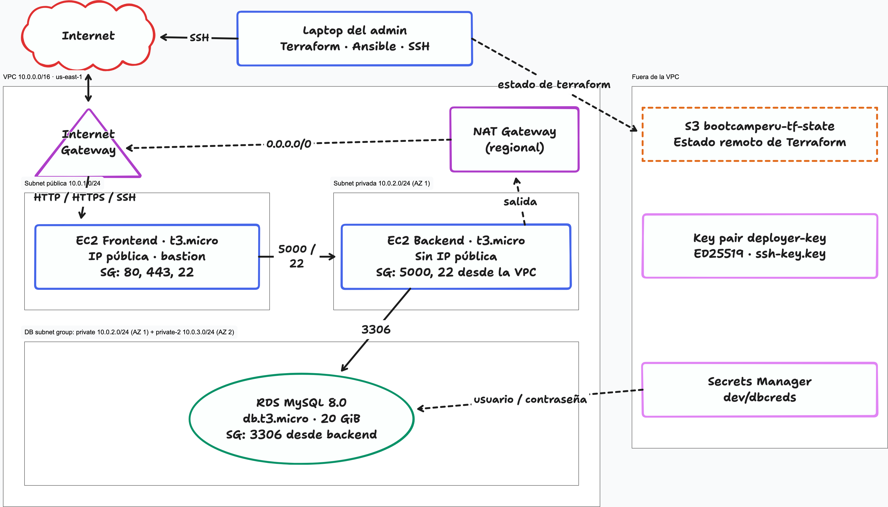

# DevOps06

Ejercicio de clase de DevOps: una aplicación web de tres capas en AWS, creada con **Terraform** y configurada con **Ansible**. Terraform levanta la red, los servidores, el balanceador y la base de datos. Ansible entra después a esos servidores e instala lo que corre encima: Caddy en los frontends, una API Flask en los backends y la sincronización de hora en todos.

El resultado se puede ver en el navegador. La página dice qué frontend respondió y, cada 5 segundos, consulta `/api/` para mostrar qué backend contestó y si ese backend logró hablar con MySQL. Recargar la página o esperar unos segundos deja ver al balanceador de carga en acción.

Todo el código está comentado en español, archivo por archivo, pensado para leerse en clase.



## Qué se construye

| Capa | Recurso | Dónde vive | Qué hace |
|---|---|---|---|
| Entrada | Application Load Balancer `frontend-alb` | subnets `public` y `public-2` | Recibe HTTP en el puerto 80 y reparte entre los frontends sanos |
| Web | 5 instancias EC2 `t3.micro` (`frontend-0` a `frontend-4`) | subnets `public` (0, 2, 4) y `public-2` (1, 3) | Caddy sirve la página y reenvía `/api/*` a los backends |
| API | 2 instancias EC2 `t3.micro` (`backend-0`, `backend-1`) | subnets `private` y `private-2`, una por AZ | Flask con Gunicorn en el puerto 5000, consulta MySQL |
| Datos | RDS MySQL 8.0 `db.t3.micro`, 20 GiB | DB subnet group `private` + `private-2` | Base de datos administrada por AWS |
| Secretos | Secrets Manager `dev/dbcreds` | servicio regional de AWS | Usuario y contraseña de la base, generados al azar |
| Estado | Bucket S3 `bootcamperu-tf-state` | fuera de la VPC | Estado remoto de Terraform, con bloqueo nativo de S3 |

La red es una VPC `10.0.0.0/16` en `us-east-1`, repartida en dos zonas de disponibilidad:

| Subnet | CIDR | Zona | Sale a internet por |
|---|---|---|---|
| `public` | `10.0.1.0/24` | AZ A | Internet Gateway |
| `public-2` | `10.0.4.0/24` | AZ B | Internet Gateway |
| `private` | `10.0.2.0/24` | AZ A | NAT Gateway |
| `private-2` | `10.0.3.0/24` | AZ B | NAT Gateway |

Las zonas A y B se sortean con `random_shuffle` entre las que cumplen dos condiciones: están activas y ofrecen `t3.micro`. La segunda condición importa: en `us-east-1`, la zona `us-east-1e` está activa pero no tiene ese tipo de instancia. El sorteo queda guardado en el estado, así que no cambia en cada `apply`.

Cada capa tiene presencia en las dos zonas. El ALB exige subnets en al menos dos zonas, RDS pide lo mismo para su subnet group, y los frontends y backends se reparten entre ambas. Si se cae una zona, siguen respondiendo los servidores de la otra.

## Tecnologías y cómo encajan

### Terraform: la infraestructura

Terraform lee los archivos `.tf`, compara lo que describen con lo que ya existe en AWS y crea, cambia o borra solo la diferencia. Usa cuatro providers:

- **aws**: todos los recursos de AWS (VPC, EC2, ALB, RDS, Secrets Manager).
- **random**: la contraseña de la base, el nombre de usuario y la zona de disponibilidad. Los valores se guardan en el estado, así que no cambian en cada `apply`.
- **tls**: genera la llave SSH ED25519 sin salir de Terraform.
- **local**: escribe dos archivos en tu máquina, la llave privada (`terraform/ssh-key.key`) y el inventario de Ansible (`ansible/inventory.ini`).

El estado (el archivo que relaciona cada bloque de código con su recurso real en AWS) vive cifrado en S3. Con `use_lockfile`, dos personas no pueden aplicar cambios al mismo tiempo.

### La red y los security groups

Los security groups son el firewall de cada recurso y dejan pasar solo esto:

- **ALB**: puerto 80 desde internet.
- **Frontends**: 80, 443 y 22 desde internet.
- **Backends**: 5000 y 22, pero solo desde dentro de la VPC.
- **RDS**: 3306, y solo desde instancias que tengan el security group del backend. Ni los frontends ni internet llegan a la base.

Los backends no tienen IP pública. Salen a internet (para instalar paquetes) por un NAT Gateway en modo regional, que no deja entrar conexiones desde fuera.

### Ansible: la configuración

Terraform termina escribiendo `ansible/inventory.ini` a partir de una plantilla (`terraform/templates/inventory.ini.tpl`). Ese inventario es el puente entre las dos herramientas. Trae:

- los grupos `frontend` y `backend` con las IPs reales;
- la ruta de la llave SSH;
- el salto por `frontend-0` para llegar a los backends (`ProxyCommand`), porque desde tu máquina no hay ruta directa a una IP privada;
- los datos de la base (host, nombre, nombre del secreto y región). La contraseña no está ahí.

El playbook (`ansible/playbook.yaml`) aplica tres roles, en este orden:

1. **`common`**, en todos los servidores: espera a que cloud-init termine el primer arranque e instala **chrony**, apuntado a Amazon Time Sync (`169.254.169.123`), el servidor de hora que AWS expone dentro de cada instancia.
2. **`backend`**: instala Flask, PyMySQL y Gunicorn desde los paquetes de Ubuntu (Ubuntu 24.04 no permite `pip install` fuera de un entorno virtual). Lee el secreto de Secrets Manager desde tu máquina, escribe las credenciales en `/etc/devops06-api.env` con permisos `0600` y deja la API como servicio de systemd (`devops06-api`). Al final llama a la API para comprobar que llega a MySQL.
3. **`frontend`**: configura **Caddy** con una plantilla. La página de inicio se arma con *facts* (datos que Ansible recoge del servidor, como el hostname) y *variables mágicas* (`inventory_hostname`, `group_names`, `groups`, `hostvars`). El Caddyfile lista a todos los backends del inventario y los alterna con `round_robin`.

### Lo que corre en los servidores

- **Caddy** (frontends): servidor web. Sirve la página estática y reenvía `/api/*` a los backends, quitando el prefijo `/api`. Si un backend no acepta la conexión, prueba con el otro durante hasta 5 segundos.
- **Flask + Gunicorn** (backends): una API de un solo endpoint (`ansible/roles/backend/files/app.py`). Responde JSON con el hostname del backend, la versión de MySQL y la hora de la base. Si no llega a MySQL, devuelve 503 con el error.
- **MySQL en RDS**: AWS se encarga del sistema operativo, los parches y los backups.

### El recorrido de una petición

1. El navegador abre el DNS del ALB.
2. El ALB elige un frontend sano (lo comprueba con `GET /`, cada 30 segundos por defecto) y le pasa la petición.
3. Caddy devuelve la página. El JavaScript de la página pide `/api/` cada 5 segundos.
4. Esa petición vuelve a pasar por el ALB y Caddy la reenvía a uno de los backends por el puerto 5000.
5. Flask abre una conexión a MySQL en el puerto 3306, ejecuta `SELECT VERSION(), NOW()` y responde.

### El recorrido de la contraseña

Terraform genera usuario y contraseña con `random_pet` y `random_password`, los guarda en Secrets Manager y crea RDS con esas credenciales. Al desplegar, Ansible lee el secreto desde tu máquina con tus credenciales de AWS y lo deja en el backend. La contraseña no se escribe en ningún archivo del repositorio, ni siquiera en el inventario. Sí queda en el estado de Terraform, y por eso el estado vive cifrado en S3.

## Estructura del repositorio

```text
terraform/
  providers.tf     providers, backend S3 y etiquetas por defecto
  network.tf       VPC, subnets, Internet Gateway, NAT Gateway y route tables
  security.tf      security groups de frontend, backend, base de datos y salida
  compute.tf       AMI de Ubuntu, frontends, backends y RDS
  alb.tf           balanceador, target group y listener
  secrets.tf       usuario, contraseña y Secrets Manager
  ssh.tf           llave SSH y key pair
  ansible.tf       genera ansible/inventory.ini
  outputs.tf       IPs y comandos SSH listos para copiar
  templates/       cloud-init de los frontends y plantilla del inventario
ansible/
  ansible.cfg      inventario por defecto y pipelining de SSH
  playbook.yaml    los tres plays: common, backend, frontend
  group_vars/      variables compartidas (puerto de la API)
  roles/           common, backend y frontend
docs/              diagramas de arquitectura
```

## Cómo usarlo

### Requisitos

- Una cuenta de AWS con credenciales configuradas en tu máquina (`aws configure` o variables de entorno). Las usan Terraform y también Ansible, para leer el secreto.
- El bucket S3 `bootcamperu-tf-state` creado de antemano. Terraform no lo crea porque guarda en él su propio estado.
- Terraform y Ansible. Probado con Terraform 1.17 y ansible-core 2.21.
- La colección `amazon.aws` y `boto3`. Vienen incluidas en el paquete completo `ansible` (por ejemplo, el de Homebrew). Con `ansible-core` solo, instala la colección con `ansible-galaxy collection install amazon.aws` y agrega `boto3` al mismo Python que usa Ansible.

### 1. Crear la infraestructura

```bash
cd terraform
terraform init
terraform plan -out=plan.tfplan
terraform apply plan.tfplan
```

Terraform pide la variable `environment` si no está en `terraform.tfvars` (en este repositorio es `dev`). RDS es lo más lento: tarda entre 5 y 10 minutos.

### 2. Configurar los servidores

```bash
cd ../ansible
ansible-playbook playbook.yaml
```

En macOS, exporta antes esta variable o agrégala a `~/.zshrc`:

```bash
export OBJC_DISABLE_INITIALIZE_FORK_SAFETY=YES
```

Sin ella, la tarea que lee el secreto falla con `A worker was found in a dead state`. Ansible crea cada worker con `fork()`, boto3 consulta la configuración de proxy del sistema y macOS mata al proceso hijo que usa esas librerías después de un fork. `export no_proxy='*'` también lo evita, pero ignora cualquier proxy que tengas configurado.

Para aplicar solo una parte: `--limit backend` corre sobre un grupo y `--tags ntp` solo las tareas de hora.

### 3. Probarlo

El DNS del ALB no está en los outputs. Se consulta así:

```bash
aws elbv2 describe-load-balancers --names frontend-alb \
  --query 'LoadBalancers[0].DNSName' --output text
```

Abre esa dirección en el navegador. Cada recarga puede mostrar otro frontend, y la tabla "Conexión con el backend" alterna entre `backend-0` y `backend-1`. Para ver un fallo, detén la API en un backend (`sudo systemctl stop devops06-api`). Cuando Caddy le toca ese backend, la conexión es rechazada y reintenta con el otro, así que la página sigue mostrando "Conectado", ahora siempre con el mismo backend.

Para entrar por SSH:

```bash
terraform output frontend-login   # un frontend, directo
terraform output backend-login    # cada backend, saltando por frontend-0
```

### 4. Borrarlo todo

```bash
cd terraform
terraform destroy
```

Conviene hacerlo al terminar la clase. El NAT Gateway, el ALB y RDS cobran por hora aunque no reciban tráfico.

## Limitaciones conocidas

Son decisiones para mantener el ejercicio simple, no lo que se haría en producción:

- El puerto 22 de los frontends está abierto a todo internet. Lo razonable es limitarlo a tu IP (`/32`).
- RDS es una sola instancia (no Multi-AZ). Vive en una de las dos zonas; si esa zona falla, la API responde 503 hasta que la zona vuelva.
- Solo hay HTTP. Para HTTPS haría falta un dominio y un certificado en el ALB.
- La etiqueta `DateCreated` usa la fecha del plan, así que un `apply` en otro día actualiza esa etiqueta en todos los recursos.
- `skip_final_snapshot = true`: al destruir RDS no queda copia de los datos.
